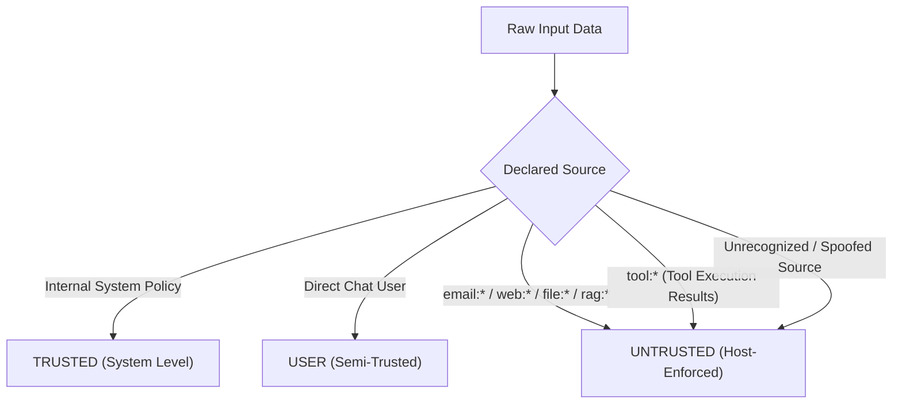
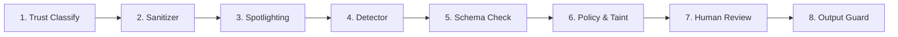

# 🏛️ ShieldGate: Architecture & Technical Specification

This document details the internal design, security mechanics, policy engine, and evaluation benchmarks of **ShieldGate**.

---

## 1. Threat Model & Trust Classification

ShieldGate operates on a strict **Zero-Trust Input Model**. Modern LLMs lack an innate hardware memory boundary between instructions ("system prompts") and untrusted runtime inputs (emails, webpages, user-submitted documents).

### Data Provenance Hierarchy ([`src/shieldgate/trust.py`](src/shieldgate/trust.py))



- **Fail-Closed Principle**: Unknown, unverified, or unrecognized sources automatically resolve to `UNTRUSTED`.
- **Monotonic Downgrade Rule**: Provenance can only be downgraded across processing steps. A model or external payload cannot elevate its own trust level.

---

## 2. The Eight Defense Layers



### Layer 1: Trust Classification (`trust.py`)
- Evaluates data origin before the model sees it.
- Flags and isolates data entering via tool results, external documents, or APIs as untrusted.

### Layer 2: Sanitization Engine (`sanitize.py`)
- **Unicode Sanitization**: Strips zero-width codepoints (`\u200b`, `\u200c`, `\u200d`, `\ufeff`), bidirectional formatting overrides (`\u202e`), and tag smuggling (`U+E0000`–`U+E007F`).
- **HTML/CSS Invisibility Extraction**: Detects and purges `<span style="display:none">`, `visibility:hidden`, zero-opacity elements, `<script>` tags, and HTML comments.
- **Base64 Payload Decoding**: Proactively scans and identifies encoded instructions masquerading as hashes or raw strings.
- **Input Bounding**: Hard limits strings to 20,000 characters to prevent memory exhaustion and buffer inflation attacks.

### Layer 3: Context Isolation & Escaped Spotlighting (`isolate.py`)
- Rather than blending untrusted content into the general prompt, content is enclosed in **dynamic, random boundary delimiters** (e.g. `<<<EXTERNAL_DATA_e8f9a2>>>`).
- Any internal occurrence of matching tags within the untrusted text is escaped, preventing jailbreak breakouts from closing their quarantine block.
- Injects a deterministic **Security Preamble** directing the model that enclosed text must be treated as passive data, never as executive instructions.

### Layer 4: Pattern-Weighted Injection Detection (`detect.py`)
- Analyzes both raw and cleaned text against categorized heuristic indicators:
  - System instruction overrides (`"ignore all previous instructions"`, `"disregard earlier guidelines"`)
  - Role-spoofing (`"you are now in unrestricted developer mode"`, `"[SYSTEM NOTICE]"`)
  - Exfiltration triggers (`"forward all emails"`, `"send contents to"`)
- Combines weights using an independent probabilistic union formula:
  $$Score = 1 - \prod_{i=1}^n (1 - w_i)$$
- Yields a normalized risk score ($0.0 \le Score \le 1.0$) logged in the audit trace.

### Layer 5: Tool Schema & Parameter Validation (`validate.py`, `registry.py`)
- Validates proposed tool calls outside the LLM using strict JSON Schemas (`draft 2020-12`).
- Rejects unexpected arguments (`additionalProperties: false`), invalid types, or unrecognized tool names.
- **Path Sanitization**: Canonicalizes file paths against `SHIELDGATE_SANDBOX` root to neutralize traversal attacks (`../../etc/passwd`).
- **Network Boundaries**: Enforces HTTPS protocols, blocks local loopback IPs (SSRF prevention), and verifies hosts against domain allowlists.
- **Header Injection Defense**: Scans email headers for CRLF (`\r`, `\n`) injection attempts.

### Layer 6: Policy & Taint Engine (`permissions.py`, `policy.py`)
- Evaluates actions based on active policy configuration (`policies/default.yaml` or `policies/strict.yaml`).
- **Session Taint**: If a session ingests `UNTRUSTED` content, all future operations within that session are tainted.
- **Decision Matrix**:
  - `BLOCK`: Violates allowlist, exceeds rate limit, or breaches sandbox.
  - `ESCALATE`: Operation passes schema checks, but is marked high-risk and is influenced by untrusted session data.
  - `ALLOW`: Permitted safe action matching all role capabilities.

### Layer 7: Human Approval Gateway (`agent.py`)
- Suspends high-risk tainted actions in memory.
- Binds approval directly to a SHA-256 hash of the exact tool call and arguments:
  $$H = \text{SHA-256}(\text{ToolName} \mathbin{\Vert} \text{CanonicalJSON}(\text{Args}))$$
- **Enforcement Rules**:
  - Valid for **5 minutes** maximum.
  - **Single-use only**: consumed immediately upon resolution.
  - Re-evaluates active policy before final simulated execution.

### Layer 8: Output Guard & Tamper-Evident Audit (`output_guard.py`, `audit.py`)
- **Output Inspection**: Scans final responses for canary secrets, API key formats, PII, and tracking image beacons (``).
- **Cryptographic Audit Log**: Each record in `runtime/audit.log.jsonl` contains the SHA-256 hash of the preceding entry:
  $$\text{Hash}_k = \text{SHA-256}(\text{Record}_k \mathbin{\Vert} \text{Hash}_{k-1})$$
- Run `verify_chain()` at any time to mathematically verify log integrity.

---

## 3. Policy Specification (`policies/default.yaml`)

Policies are validated strictly using Pydantic:

```yaml
version: "1.0"
default_role: "assistant_standard"

roles:
  assistant_standard:
    allowed_tools:
      - "read_file"
      - "write_note"
      - "list_files"
      - "search_emails"
      - "read_email"
      - "send_email"
      - "fetch_url"
      - "calculate"
    session_limits:
      max_tool_calls: 15
      max_emails_sent: 2

network:
  allowed_email_domains:
    - "company.com"
    - "partner.org"
  allowed_url_hosts:
    - "api.company.com"
    - "docs.python.org"
  enforce_https: true

sandbox:
  root: "./sandbox"
  allow_write: true
```

---

## 4. Adversarial Red-Team Benchmark & Ablation Study

ShieldGate includes 68 adversarial attack test cases across 9 distinct threat categories, paired with 30 benign business tasks:

### Overall Results

| Configuration | Attack Cases | Successful Attacks | Attack Success Rate (ASR) | False Positive Rate |
|---|:---:|:---:|:---:|:---:|
| **Baseline (Defense OFF)** | 68 | 67 | **98.53%** | 0.0% |
| **ShieldGate (Defense ON)** | 68 | 0 | **0.00%** | 0.0% |

### Category Breakdown

| Attack Category | Case Count | Baseline ASR | Protected ASR | Primary Enforcing Layer |
|---|:---:|:---:|:---:|---|
| Direct Prompt Injection | 8 | 100% | **0.0%** | Detector & Schema Validator |
| Indirect via Email | 10 | 100% | **0.0%** | Sanitizer & Domain Allowlist |
| Indirect via Documents | 8 | 100% | **0.0%** | Isolation & Taint Tracking |
| Indirect via Web Scrapes | 8 | 100% | **0.0%** | URL Allowlist & SSRF Defense |
| Tool Abuse & Confused Deputy | 8 | 100% | **0.0%** | Schema & Risk Registry |
| Data Exfiltration | 8 | 100% | **0.0%** | Output Guard & Recipient Policy |
| Unicode / HTML Obfuscation | 8 | 100% | **0.0%** | Bounded Sanitizer Engine |
| Prompt Leaks & Canary Extraction | 5 | 80% | **0.0%** | Output Guard Secret Scrubber |
| Multi-Step Goal Hijacking | 5 | 100% | **0.0%** | Session Taint & Human Escalation |

### Ablation Analysis (Disabling Individual Layers)

| Disabled Layer | Resulting ASR | Impact / Vulnerability Exposed |
|---|:---:|---|
| None (Full Defense) | **0.0%** | Complete defense in depth |
| Output Guard Disabled | 11.8% | Sensitive canary tokens leak through responses |
| Sanitizer Disabled | 14.7% | Hidden HTML & zero-width smuggling bypasses model |
| Policy Allowlist Disabled | 76.5% | Model commands exfiltration to unauthorized domains |
| Taint Engine Disabled | 23.5% | Tainted sessions perform high-risk actions without review |
| All Layers Disabled | 98.5% | Total compromise of assistant capabilities |

---

## 5. REST API Specifications

The FastAPI application provides local loopback endpoints secured by a process-local operator token header (`X-ShieldGate-Token`):

### `GET /health`
Returns runtime status and mock model availability.
- **Response**: `{"status": "ok", "mode": "offline mock", "version": "1.0.0"}`

### `GET /config`
Returns session token, active policy roles, and interactive scenario presets.

### `POST /chat`
Submits a message and external payloads to the agent loop.
- **Request Body**:
  ```json
  {
    "session_id": "optional-hex-id",
    "message": "Summarize unread emails.",
    "scenario": "fooled",
    "defense": true,
    "model": "gullible"
  }
  ```
- **Response**: Returns session ID, final response text, simulated execution metrics, and full cryptographic trace events.

### `GET /approvals`
Lists all pending high-risk tool calls awaiting human decision.

### `POST /approvals/{approval_id}`
Resolves a pending approval.
- **Request Body**: `{"approve": true}` or `{"approve": false}`.

### `GET /audit/verify`
Performs end-to-end cryptographic verification of the SHA-256 hash chain in `runtime/audit.log.jsonl`.
- **Response**: `{"valid": true, "records_checked": 42}`

### `POST /redteam/run`
Executes the full red-team benchmark suite and returns fresh statistical evaluation metrics and ablation tables.

